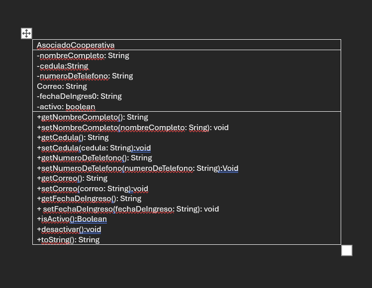
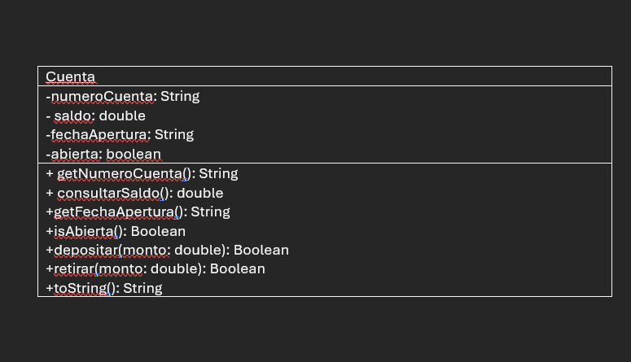
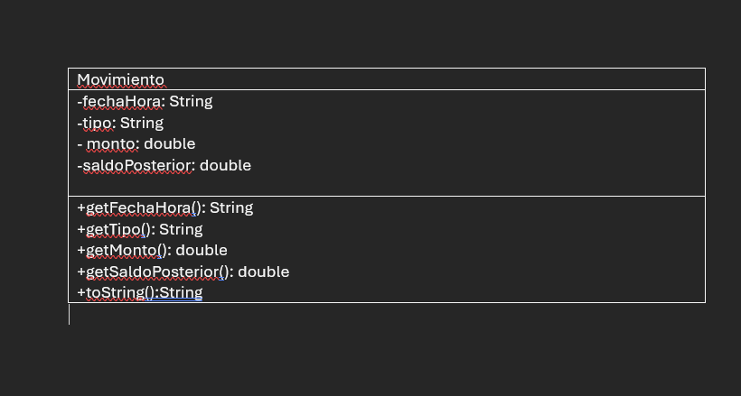
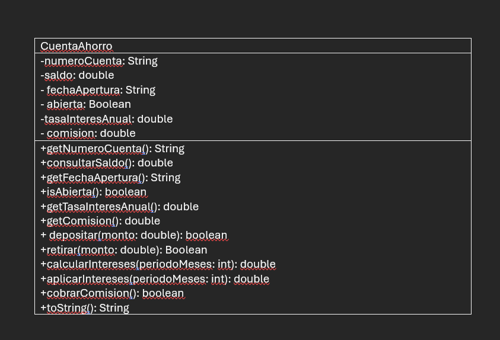
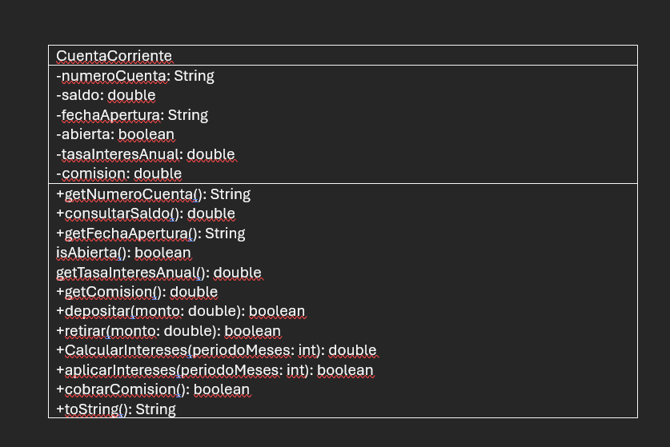
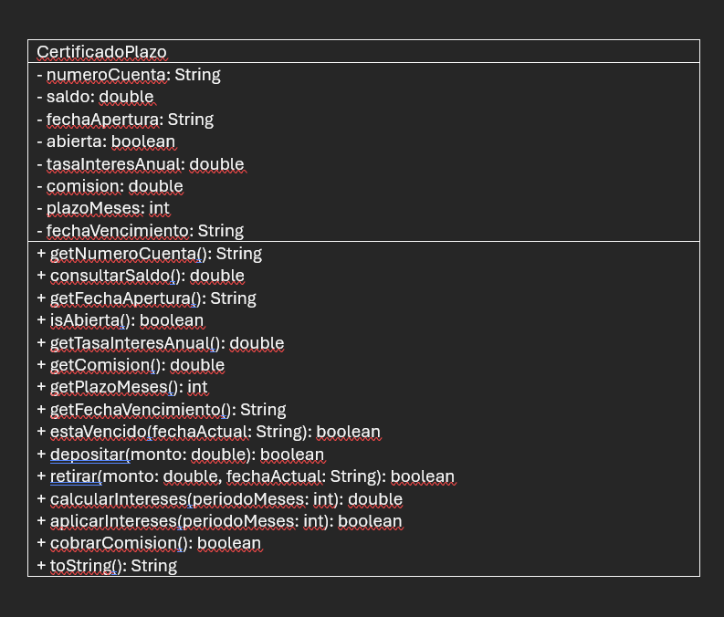

# CoopeTica — Programación II

Modelado del dominio CoopeTica R.L.  
BIS04 Programación II — Universidad Latina de Costa Rica

## Integrantes

- Abby Daniel Mendez Alvarez — GitHub: @abbydanielmendez-tech
- Jeremy Angulo Ovares — GitHub: @JeremAng

## Descripción del proyecto

CoopeTica R.L. es una cooperativa costarricense que actualmente administra sus operaciones mediante hojas de cálculo dispersas. Este proyecto presenta el diseño inicial de un sistema para organizar la información de sus asociados, sus cuentas y sus movimientos.

El modelo contempla cuentas de ahorro, cuentas corrientes y certificados a plazo. Incluye operaciones de depósito, retiro, aplicación de intereses y cobro de comisiones, además de consultas de cuentas por asociado y movimientos entre fechas.

Esta entrega contiene el diseño de clases y la evidencia del trabajo colaborativo mediante Git y GitHub. No incluye una aplicación funcional en Java.

## Diagrama de clases

### AsociadoCooperativa

### Cuenta

### Movimiento

### Cuenta de ahorro

### Cuenta corriente

### Certificado a plazo

### Documento PDF

[Consultar el documento de diagramas en PDF](DiagramaDeClases.pdf)

## Justificación del modelo

### Clases escogidas

- **AsociadoCooperativa:** representa a la persona afiliada. Guarda sus datos personales y su estado, y permite desactivarla sin eliminar su información histórica.

- **Cuenta:** representa las características y operaciones comunes de las cuentas: número, saldo, fecha de apertura, estado, depósitos, retiros y consulta de movimientos.

- **CuentaAhorro:** representa el producto de ahorro, con la tasa de interés y la comisión que le correspondan.

- **CuentaCorriente:** permite distinguir las condiciones de intereses y comisiones de este producto, aunque comparte operaciones con la cuenta de ahorro.

- **CertificadoPlazo:** incluye el plazo en meses y la fecha de vencimiento. Su retiro debe validar que se haya alcanzado esa fecha, además de comprobar el saldo disponible.

- **Movimiento:** registra la fecha y hora, el tipo de operación, el monto y el saldo posterior para mantener el historial de cada cuenta.

### Conceptos que no se modelaron como clases independientes

- **Hojas de cálculo dispersas:** describen la situación previa de la cooperativa y no una entidad del sistema propuesto.

- **Tipos de movimiento:** depósito, retiro, intereses y comisión se representan mediante el atributo `tipo` de Movimiento. Para el alcance actual no se necesitan clases independientes para cada tipo.

- **Reporte de movimientos:** se representa mediante una consulta de movimientos por cuenta entre fechas. Se conserva la funcionalidad solicitada sin agregar una clase exclusiva para el reporte.

## Notas de diseño

Los atributos se representan con visibilidad privada (`-`) y los métodos con visibilidad pública (`+`).

Las consultas devuelven información sin modificar los saldos. La consulta de cuentas incluye su estado abierto o cerrado. La consulta de movimientos contempla las fechas inicial y final del período solicitado.

Cuenta representa las características comunes de los tres productos. En esta etapa se presentan las clases sin dibujar relaciones.

El borrador utiliza una tasa anual y un período en meses como propuesta de diseño. El enunciado no establece esas unidades ni asigna valores concretos a las tasas y comisiones.

## Bitácora de uso de IA

### Uso realizado por Abby

- Consulté a ChatGPT la diferencia entre clases, atributos y métodos. Utilicé sus explicaciones para comprender cómo representar los datos y las acciones del sistema.

- Utilicé propuestas de ChatGPT como base para elaborar las tablas del diagrama, incluyendo atributos, tipos de datos y métodos. También recibí ayuda para corregir errores y agregar consultas.

- Consulté cómo utilizar Git y GitHub. Seguí las instrucciones para crear ramas, guardar cambios, subir imágenes, abrir un pull request y resolver conflictos.

- Utilicé borradores de ChatGPT para organizar el README. También recibí ayuda para combinar las versiones de los documentos durante la fusión.

## Conflicto de fusión

La práctica y su resolución se documentan en [CONFLICTO.md](CONFLICTO.md).

<!-- Practica de fusion: revisar diagramas y documentacion -->